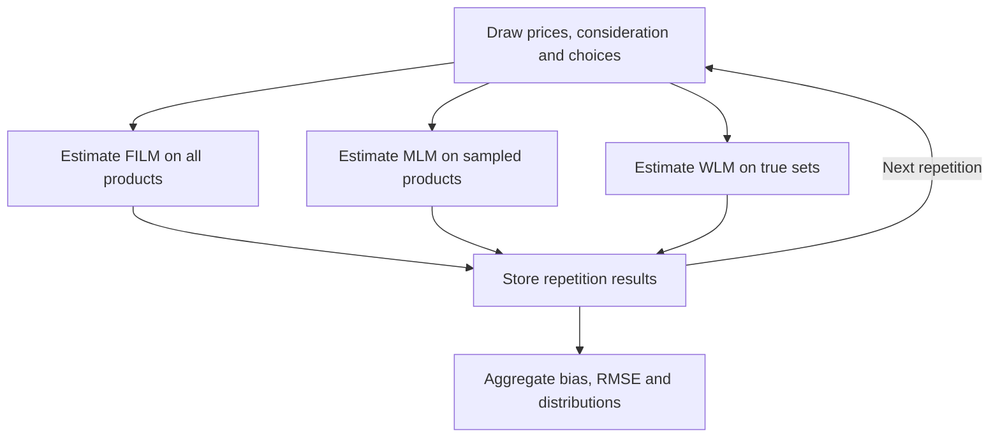

# Technical Methodology

**Logit Models under Limited Consideration**

This document describes the mathematical framework, structural estimation procedure and Monte Carlo design of the research project conducted at Heinrich Heine University Düsseldorf in 2024. The study compares preference estimates obtained using full, sampled and true consideration sets.

[Return to repository overview](README.md)

<br>

## 1. Model specification

### Decision environment

Consumers choose among ten products across repeated market occasions. The consumer, market and product indices are

```math
\begin{alignedat}{2}
&i &\quad &\in\{1,\ldots,N\},\\
&t &\quad &\in\{1,\ldots,T\},\\
&j &\quad &\in\mathcal C=\{1,\ldots,J\},\qquad J=10.
\end{alignedat}
```

<br>

Each consumer makes one choice in each market, giving $`n=NT`$ decision observations per repetition. There is no outside option. The market index identifies choice occasions; the model contains no dynamic optimisation or state dependence.

### Utility

Utility contains an observed component, an additional Gaussian component and a Type I Extreme Value shock:

```math
U_{itj}=V_{itj}+\eta_{itj}+\varepsilon_{itj},
\qquad V_{itj}=\beta_p p_{itj}+\delta_j.
```

<br>

The price coefficient and product effects are common across consumers. Product 1 is the reference category, and the true price coefficient is negative:

```math
\delta_1=0,\qquad \beta_p^0=-0.173,
\qquad \theta=(\beta_p,\delta_2,\ldots,\delta_{10})'.
```

<br>

The price coefficient $`\beta_p`$ is expressed directly as a signed parameter.

The additional utility components satisfy

```math
\eta_{itj}\overset{\mathrm{iid}}{\sim}\mathcal N(0,\sigma_\eta^2),
\qquad \sigma_\eta=0.25,
\qquad \varepsilon_{itj}\overset{\mathrm{iid}}{\sim}\mathrm{EV1}(0,1).
```

<br>

The two shock families are independent of one another and of the price and consideration draws. The Gumbel scale is normalised to one. The simulation uses $`\sigma_\eta=0.25`$. Section 3.1 of the project paper states a standard normal Gaussian component.

<br>

## 2. Prices and consideration sets

### Price generation

Prices vary independently across consumers, markets and products around product-specific list prices:

```math
p_{itj}=\frac{\overline p_j}{3}+16v_{itj},
\qquad v_{itj}\overset{\mathrm{iid}}{\sim}\mathcal U(0,1).
```

<br>

The list prices $`\overline p_j`$ are given in the calibration table below. Prices are generated independently of utility shocks; price endogeneity is not introduced in this simulation.

### Consideration probabilities

The probability that product $`j`$ enters a proposed consideration set is

```math
\phi_{itj}=\Lambda(\gamma_p p_{itj}+\gamma_j),
\qquad \Lambda(z)=\frac{1}{1+\exp(-z)}.
```

<br>

The calibration is

```math
\gamma_p=0.15,\qquad
\gamma_j=
\begin{cases}
-2.5,&j=1,\ldots,5,\\
0,&j=6,\ldots,10.
\end{cases}
```

<br>

Conditional on prices, independently draw the indicators and form the true set:

```math
w_{itj}\overset{\mathrm{iid}}{\sim}\mathcal U(0,1),\qquad
A_{itj}=\mathbf 1\{w_{itj}<\phi_{itj}\},\qquad
\mathcal D_{it}=\{j\in\mathcal C:A_{itj}=1\}.
```

<br>

Higher prices reduce utility but increase consideration probabilities. Products 6–10 also have higher consideration probabilities than products 1–5 at the same price.

### Empty-set treatment

Under the default simulation policy, an empty set triggers a redraw of all consideration indicators at the same prices. This conditions the independent Bernoulli proposal on a nonempty set:

```math
q(\mathcal D\mid\mathbf p_{it})=
\frac{
\prod_{j\in\mathcal D}\phi_{itj}
\prod_{k\notin\mathcal D}(1-\phi_{itk})
}{1-\prod_{k\in\mathcal C}(1-\phi_{itk})},
\qquad \varnothing\ne\mathcal D\subseteq\mathcal C.
```

<br>

The accepted indicators are therefore dependent through the nonempty-set restriction. Sets can contain one to ten products. Redraws are counted, and a finite retry limit prevents an endless loop. The optional `empty_set_policy="raise"` stops on an empty set instead.

<br>

## 3. Conditional choice probabilities

The consumer chooses the highest-utility alternative within the true consideration set:

```math
y_{it}=\arg\max_{j\in\mathcal D_{it}}
\{V_{itj}+\eta_{itj}+\varepsilon_{itj}\}.
```

<br>

Integrating over the Gumbel shocks while conditioning on the Gaussian draws gives

```math
P_{itj}^{\mathrm{sim}}=
\begin{cases}
\displaystyle
\frac{\exp(V_{itj}+\eta_{itj})}
{\sum_{k\in\mathcal D_{it}}\exp(V_{itk}+\eta_{itk})},
&j\in\mathcal D_{it},\\[8pt]
0,&j\notin\mathcal D_{it}.
\end{cases}
```

<br>

The implementation draws a categorical choice from these probabilities using a uniform random number and the cumulative distribution. It does not need to draw the Gumbel shocks explicitly. Gaussian utility shocks are drawn explicitly before computing the probabilities.

The probabilities sum to one for every accepted set. A singleton set implies a certain choice of its only product.

<br>

## 4. Choice sets used in estimation

The three estimators use identical choices and prices but different availability masks:

```math
\begin{aligned}
\mathcal S_{it}^{\mathrm{FILM}}&=\mathcal C,\\
\mathcal S_{it}^{\mathrm{MLM}}&=\{y_{it}\}\cup\mathcal B_{it},\\
\mathcal S_{it}^{\mathrm{WLM}}&=\mathcal D_{it}.
\end{aligned}
```

<br>

Here $`\mathcal B_{it}`$ contains four products sampled uniformly without replacement from $`\mathcal C\setminus\{y_{it}\}`$. Consequently, MLM always uses five alternatives. Its sampled set need not be a subset of the true consideration set.

| Model | Information supplied to estimation | Main distinction |
| --- | --- | --- |
| FILM | All ten alternatives | Treats every product as considered |
| MLM | Chosen product and four sampled alternatives | Sampling does not reveal actual consideration |
| WLM | Actual consideration set | Provides the true-set benchmark |

<br>

All three fitted models use the observed utility component $`V_{itj}(\theta)`$ and omit $`\eta_{itj}`$. Their probabilities are

```math
P_{itj}^{m}(\theta)=
\frac{\mathbf 1\{j\in\mathcal S_{it}^{m}\}\exp(V_{itj}(\theta))}
{\sum_{k\in\mathcal S_{it}^{m}}\exp(V_{itk}(\theta))},
\qquad m\in\{\mathrm{FILM},\mathrm{MLM},\mathrm{WLM}\}.
```

<br>

The chosen product must belong to the estimation set. Estimation uses prices, product identities, observed choices and the selected availability mask; stored simulation probabilities are not used to fit parameters.

<br>

## 5. Sampling alternatives and the likelihood correction

Let $`\pi(\mathcal S\mid j)`$ denote the probability of drawing estimation set $`\mathcal S`$ when product $`j`$ was chosen. Suppressing covariates, conditioning a correctly specified full-set logit on the sampled set gives

```math
\begin{aligned}
\Pr_\theta(y=j\mid\mathcal S)&=
\frac{P_j(\theta)\pi(\mathcal S\mid j)}
{\sum_{k\in\mathcal S}P_k(\theta)\pi(\mathcal S\mid k)}\\[6pt]
&=\frac{\exp(V_j(\theta)+\log\pi(\mathcal S\mid j))}
{\sum_{k\in\mathcal S}\exp(V_k(\theta)+\log\pi(\mathcal S\mid k))}.
\end{aligned}
```

<br>

This is the sampling correction associated with McFadden's approach. For the implemented chosen-plus-four design,

```math
\pi(\mathcal S\mid j)=\binom{9}{4}^{-1}=\frac{1}{126},
\qquad j\in\mathcal S,\quad |\mathcal S|=5.
```

<br>

The correction is constant across candidate chosen products within a set and cancels from the ratio:

```math
\Pr_\theta(y=j\mid\mathcal S)=
\frac{\exp(V_j(\theta))}{\sum_{k\in\mathcal S}\exp(V_k(\theta))}.
```

<br>

This cancellation explains the masked logit likelihood used for MLM. It does not make the full-set logit correctly specified when true consideration is unobserved. WLM instead conditions directly on the actual set; it does not apply the chosen-plus-four sampling design.

For the general sampling argument, see McFadden (1978) and [Train (2009), Section 3.7.1](https://eml.berkeley.edu/books/choice2nd/Ch03_p34-75.pdf).

<br>

## 6. Structural parameter estimation

### Conditional likelihood

Define the feature vector for each product as

```math
\mathbf z_{itj}=
\big(p_{itj},\mathbf 1\{j=2\},\ldots,\mathbf 1\{j=10\}\big)',
\qquad V_{itj}(\theta)=\mathbf z_{itj}'\theta.
```

<br>

For model $`m`$, the conditional log-likelihood is

```math
\ell_m(\theta)=\sum_{i=1}^{N}\sum_{t=1}^{T}
\left[
\mathbf z_{it,y_{it}}'\theta
-\log\left(\sum_{j\in\mathcal S_{it}^{m}}
\exp(\mathbf z_{itj}'\theta)\right)
\right].
```

<br>

The estimator maximises this likelihood over the ten utility coefficients:

```math
\widehat\theta_m=\arg\max_{\theta\in\mathbb R^{10}}\ell_m(\theta).
```

<br>

Consideration parameters are fixed simulation inputs and are not estimated. Normalising product 1 removes the common utility-location indeterminacy; finite estimates also require sufficient variation and an identified likelihood.

### Analytic derivatives

Write $`L_m=-\ell_m`$ and flatten observations into $`d=1,\ldots,n`$, with $`n=NT`$. Define the probability-weighted feature mean

```math
\overline{\mathbf z}_d(\theta)=
\sum_{j\in\mathcal S_d^m}P_{dj}^{m}(\theta)\mathbf z_{dj}.
```

<br>

The negative log-likelihood gradient and Hessian are

```math
\nabla L_m(\theta)=\sum_{d=1}^{n}
\left[\overline{\mathbf z}_d(\theta)-\mathbf z_{d,y_d}\right],
```

<br>

```math
H_m(\theta)=\sum_{d=1}^{n}
\left[
\sum_{j\in\mathcal S_d^m}P_{dj}^{m}(\theta)\mathbf z_{dj}\mathbf z_{dj}'
-\overline{\mathbf z}_d(\theta)\overline{\mathbf z}_d(\theta)'
\right].
```

<br>

Each Hessian contribution is a covariance matrix, making the negative log-likelihood convex for fixed estimation sets. Convexity does not exclude separation or singular information. Singleton sets contribute zero log-likelihood, gradient and Hessian.

<br>

## 7. Numerical optimisation and standard errors

### Stable probability evaluation

The log-sum-exp calculation subtracts the largest available utility before exponentiation:

```math
\log\sum_{j\in\mathcal S_d^m}\exp(V_{dj})
=c_d+\log\sum_{j\in\mathcal S_d^m}\exp(V_{dj}-c_d),
\qquad c_d=\max_{j\in\mathcal S_d^m}V_{dj}.
```

<br>

Unavailable alternatives receive log probability $`-\infty`$. Boolean masks exclude them from the likelihood denominator.

### Optimisation procedure

The numerical objective is the average negative log-likelihood:

```math
Q_m(\theta)=\frac{L_m(\theta)}{n},\qquad
\nabla Q_m(\theta)=\frac{\nabla L_m(\theta)}{n},\qquad
\nabla^2Q_m(\theta)=\frac{H_m(\theta)}{n}.
```

<br>

Scaling leaves the minimiser unchanged and makes objective magnitudes comparable across sample sizes.

| Computational component | Implementation |
| --- | --- |
| Starting parameters | Zero vector |
| Primary optimiser | SciPy `trust-exact` with analytic gradient and Hessian |
| Fallback optimiser | BFGS with analytic gradient |
| Accepted result | Successful optimisation and usable likelihood curvature |
| Recorded diagnostics | Likelihood, optimiser, iterations and maximum absolute average gradient |

<br>

Input checks reject invalid choice sets, a chosen product outside its set, and datasets in which a product is never chosen. Curvature checks address singular or poorly conditioned information matrices.

### Conventional model-based standard errors

Covariance is computed from the Hessian of the **total** negative log-likelihood:

```math
\begin{aligned}
\widehat{\operatorname{Var}}_{\mathrm{model}}(\widehat\theta_m)
&=H_m(\widehat\theta_m)^{-1},\\[6pt]
\widehat{\mathrm{SE}}_{m,k}
&=\sqrt{\left[H_m(\widehat\theta_m)^{-1}\right]_{kk}}.
\end{aligned}
```

<br>

The implementation checks positive definiteness and numerical conditioning before inversion. Using the average-objective Hessian would require dividing its inverse by $`n`$. These are conventional model-based standard errors, not sandwich-robust standard errors under misspecification.

<br>

## 8. Monte Carlo experimental design

### Baseline calibration

| Product | Utility effect $`\delta_j`$ | List price $`\overline p_j`$ | Consideration intercept $`\gamma_j`$ |
| ---: | ---: | ---: | ---: |
| 1 | 0.000 | 22.98 | −2.5 |
| 2 | 0.368 | 24.98 | −2.5 |
| 3 | −0.497 | 22.98 | −2.5 |
| 4 | 0.093 | 22.98 | −2.5 |
| 5 | 0.088 | 24.98 | −2.5 |
| 6 | 0.306 | 25.00 | 0 |
| 7 | −0.581 | 24.98 | 0 |
| 8 | −1.075 | 19.98 | 0 |
| 9 | −0.909 | 24.98 | 0 |
| 10 | −0.405 | 24.98 | 0 |

<br>

The common coefficients are $`\beta_p^0=-0.173`$ and $`\gamma_p=0.15`$, with Gaussian utility standard deviation $`\sigma_\eta=0.25`$.

### Experiment profiles

| Experiment | Consumers $`N`$ | Markets $`T`$ | Repetitions $`R`$ | Choices per repetition |
| --- | ---: | ---: | ---: | ---: |
| Table 1 | 50 | 100 | 100 | 5,000 |
| Density: 10 markets | 100 | 10 | 50 | 1,000 |
| Density: 50 markets | 100 | 50 | 50 | 5,000 |
| Density: 100 markets | 100 | 100 | 50 | 10,000 |
| Density: 200 markets | 100 | 200 | 50 | 20,000 |

<br>

The full design generates 300 datasets, 2,300,000 decision observations and 900 model estimations. Each dataset supplies the same choices and prices to all three estimators.

### Simulation and repetition

For each experiment and repetition:

1. Generate prices and a nonempty consideration set for each consumer-market observation.
2. Draw Gaussian utilities and simulate a choice from the conditional logit probabilities.
3. Construct the full, sampled and true estimation masks.
4. Estimate all three models and retain estimates, standard errors and diagnostics.
5. Aggregate results across repetitions and compare estimates with known parameters.



<br>

The NumPy generator is initialised separately for repetition $`r`$ using

```math
\operatorname{seed}(r)=22{,}102{,}024+r,\qquad r=1,\ldots,R.
```

<br>

The seed rule restarts for each experiment. Results across market counts can therefore be statistically dependent through shared random streams; they are not independent simulation batches. Within each dataset, the consumer index is the outer simulation loop and the market index is the inner loop.

<br>

## 9. Statistical evaluation

### Parameter recovery

For a parameter with true value $`\theta_k^0`$, calculate

```math
\begin{aligned}
\overline{\widehat\theta}_k
&=\frac{1}{R}\sum_{r=1}^{R}\widehat\theta_k^{(r)},\\
\widehat{\operatorname{Bias}}_k
&=\overline{\widehat\theta}_k-\theta_k^0,\\
\widehat{\operatorname{RMSE}}_k
&=\sqrt{\frac{1}{R}\sum_{r=1}^{R}
\left(\widehat\theta_k^{(r)}-\theta_k^0\right)^2}.
\end{aligned}
```

<br>

Bias measures the displacement of the estimated mean from the truth. RMSE also reflects dispersion across simulated samples.

### Monte Carlo uncertainty

The sample standard deviation and Monte Carlo standard error of the mean are

```math
\begin{aligned}
s_{\mathrm{MC},k}
&=\sqrt{\frac{1}{R-1}\sum_{r=1}^{R}
\left(\widehat\theta_k^{(r)}-\overline{\widehat\theta}_k\right)^2},\\
\operatorname{MCSE}(\overline{\widehat\theta}_k)
&=\frac{s_{\mathrm{MC},k}}{\sqrt R}.
\end{aligned}
```

<br>

Because the true value is fixed, the estimated bias has the same Monte Carlo standard error as the mean estimate.

### Table 1 convention

The parenthesised values in Table 1 are averages of the model-based standard errors from individual fits:

```math
\overline{\mathrm{SE}}_{\mathrm{model},k}
=\frac{1}{R}\sum_{r=1}^{R}\widehat{\mathrm{SE}}_k^{(r)}.
```

<br>

Table 1 attaches stars using the following descriptive ratio:

```math
t_k^{\mathrm{paper}}
=\frac{\overline{\widehat\theta}_k}
{\overline{\mathrm{SE}}_{\mathrm{model},k}}.
```

<br>

| Absolute ratio | Display |
| --- | :---: |
| At least 2.576 | \*\*\* |
| At least 1.960, below 2.576 | \*\* |
| At least 1.645, below 1.960 | \* |
| Below 1.645 | No stars |

<br>

The ratio is not a test of the Monte Carlo mean or of equality to the true parameter, and its denominator is not a Monte Carlo standard error.

The README reports understatement of the price-coefficient magnitude as

```math
100\frac{|\beta_p^0|-|\overline{\widehat\beta}_p|}{|\beta_p^0|}.
```

<br>

For a negative coefficient, this is positive when the mean estimate is closer to zero than the true coefficient.

<br>

## 10. Density estimation

For each model and market count, the $`R=50`$ price estimates are smoothed with a Gaussian kernel:

```math
\widehat f(b)=\frac{1}{Rh}\sum_{r=1}^{R}
\varphi\left(\frac{b-\widehat\beta_p^{(r)}}{h}\right),
\qquad
\varphi(z)=\frac{1}{\sqrt{2\pi}}\exp\left(-\frac{z^2}{2}\right).
```

<br>

The bandwidth follows the normal-reference rule of thumb:

```math
h=0.9\min\left\{s,\frac{\operatorname{IQR}}{1.34}\right\}R^{-1/5},
```

<br>

where $`s`$ is the sample standard deviation and IQR is the interquartile range of the estimates. If the scale is zero, the implementation falls back to a positive scale using the standard deviation, the absolute first observation, or one, in that order.

The Python code evaluates the Gaussian mixture directly on 2,048 grid points. It retains all estimates and uses common axes that include the true price coefficient.

<br>

## 11. Interpretation of the findings

### Structural estimation under misspecification

The researcher who does not observe consideration sets faces a mixture over those sets and over the Gaussian utility component. Suppressing consumer-market indices, the actual choice probability is

```math
\Pr_0(y=j\mid\mathbf p)=
\sum_{\mathcal D\ni j}q(\mathcal D\mid\mathbf p)
\mathbb E_\eta\left[
\frac{\exp(V_j^0+\eta_j)}
{\sum_{k\in\mathcal D}\exp(V_k^0+\eta_k)}
\right].
```

<br>

This generally differs from the full-set logit at the true utility coefficients. Under standard regularity conditions, a misspecified likelihood targets the parameter vector that best fits the actual choice distribution within that model:

```math
\theta_m^*=\arg\max_\theta\;
\mathbb E_0\left[\log P_m(y\mid\mathcal S^m,\mathbf p;\theta)\right].
```

<br>

The target need not equal $`\theta^0`$. More observations can concentrate estimates around a displaced target without correcting the specification.

### Preference recovery with different sets

| Model | Mean price estimate, Table 1 | Understatement of magnitude |
| --- | ---: | ---: |
| FILM | −0.106218 | 38.60% |
| MLM | −0.105787 | 38.85% |
| WLM | −0.171502 | 0.87% |

<br>

FILM combines preference and consideration effects in a likelihood that assumes universal consideration. MLM changes the estimation subset without observing actual consideration. WLM supplies the correct set and substantially improves recovery, but it still omits the Gaussian component.

Conditional logit satisfies IIA within a fixed set and for fixed utilities. Introducing another term into its denominator does not alter the odds between two existing alternatives. The issue here is whether those logit odds describe observed choices after the unobserved sets and utility components are averaged out.

**Central insight:** Sampling alternatives and modelling consideration are distinct operations. A valid computational sampling rule does not by itself identify the alternatives that actually entered a consumer's decision.

<br>

## 12. Implementation architecture

| Module | Purpose |
| --- | --- |
| `config.py` | Structural parameters, experiment profiles and seeds |
| `simulation.py` | Prices, consideration sets, choices and availability masks |
| `estimation.py` | Conditional likelihood, derivatives, optimisation and standard errors |
| `monte_carlo.py` | Table 1 and small demonstration experiments |
| `monte_carlo_density.py` | Experiments across four market counts |
| `plot_results.py` | Density figures and formatted Table 1 |

<br>

Each experiment saves repetition-level estimates, summary statistics, a model comparison table and a settings file. The settings include software versions and a completion flag. Figures and formatted tables are generated from these saved results.

<br>

## 13. Limitations and reproducibility

- Gaussian utility shocks use standard deviation 0.25. The simulation conditions consideration sets on being nonempty through resampling.
- WLM observes the true consideration sets by construction. The project does not estimate unknown sets or jointly estimate a consideration model.
- Gaussian utility heterogeneity is omitted from all three fitted logit models. WLM's closer estimates do not establish exact unbiasedness or asymptotic consistency.
- Conventional curvature-based standard errors and the star convention do not provide misspecification-robust inference. Monte Carlo variability is reported separately.
- Increasing sample sizes is a finite-sample experiment, not a general proof of consistency. The exercise uses simulated data and does not establish performance under endogenous prices or empirical market heterogeneity.
- The reported curves come from newly simulated datasets in each repetition, not bootstrap resamples of a fixed dataset.

<br>

## 14. References

- Abaluck, J., & Adams-Prassl, A. (2021). What do consumers consider before they choose? Identification from asymmetric demand responses. *The Quarterly Journal of Economics*, 136(3), 1611–1663.
- McFadden, D. (1978). Modelling the choice of residential location. In *Spatial Interaction Theory and Planning Models*, pp. 75–96. North-Holland.
- Train, K. E. (2009). *Discrete Choice Methods with Simulation*, second edition. Cambridge University Press. [Chapter 3: Logit](https://eml.berkeley.edu/books/choice2nd/Ch03_p34-75.pdf).
- White, H. (1982). Maximum likelihood estimation of misspecified models. *Econometrica*, 50(1), 1–25.

---

**Author:** Elias Roth

Based on original research conducted at Heinrich Heine University Düsseldorf in 2024.

[Return to repository overview](README.md)
