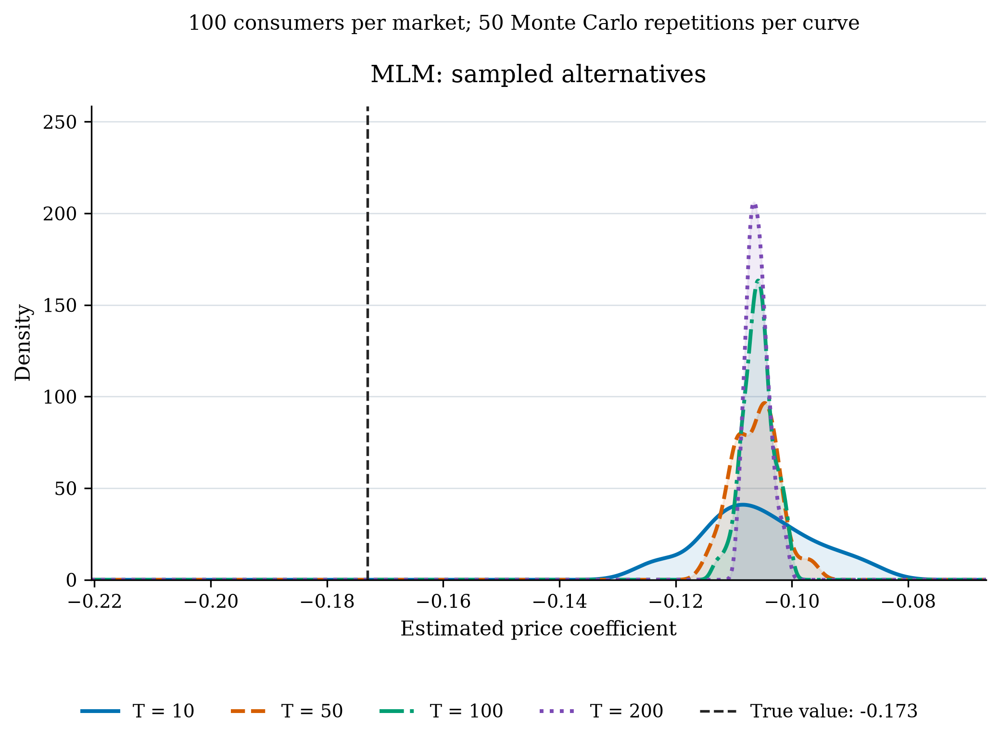
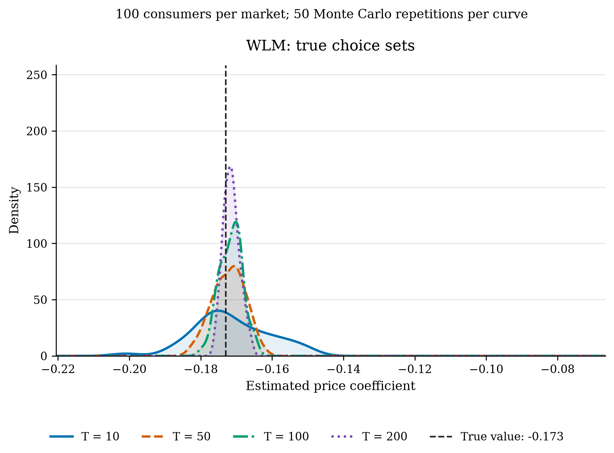

# Logit Models under Limited Consideration

**Statistical Modelling · Structural Estimation · Monte Carlo Simulation · Model Misspecification**


## Overview

Can a choice model recover preferences when it does not know which alternatives consumers actually considered?

I developed a Python simulation and structural estimation framework to investigate how unobserved consideration sets affect parameter recovery in multinomial logit models. The framework combines stochastic choice simulation, three maximum likelihood estimation approaches and controlled Monte Carlo experiments to quantify the effects of model misspecification and increasing sample size.

**Key finding:** Both treating all products as considered and randomly sampling alternatives underestimate the magnitude of the price coefficient by approximately **39%** in the baseline experiment. Using the true consideration sets substantially improves parameter recovery.

[Technical Methodology](METHODOLOGY.md) · [Simulation outputs](results/) · [Figures](figures/) · [Statistical tables](tables/)

<br>

## Project Highlights

| Experimental scale | Value |
| :--- | ---: |
| Simulated choice observations | **2,300,000** |
| Maximum likelihood estimations | **900** |
| Monte Carlo datasets | 300 |
| Estimation approaches compared | 3 |
| Sample sizes in density experiments | 1,000–20,000 choices |

Each simulated dataset is used by all three estimators, allowing direct comparisons under identical data-generating conditions. Model parameters, sample sizes and repetition seeds are configurable in [config.py](config.py).

<br>

## The Decision Problem

A consumer chooses one of ten products on each market occasion. Products differ in price and product-specific utility effects. The consumer considers only a subset of these products, so an unconsidered product cannot be chosen.

Price enters the decision through two channels:

- **Preferences:** A higher price reduces utility, holding other utility components fixed. The true price coefficient is −0.173.
- **Consideration:** A higher price increases the probability that a product enters the consumer's consideration set in this calibration. Consideration probabilities also differ across products.

The researcher observes choices, prices and product identities, but generally does not know which products were considered. A product may be unchosen because the consumer dislikes it or because it never entered the consideration set.

The framework implements and compares three estimation approaches using the same simulated choices:

| Model | Alternatives used for estimation |
| :--- | :--- |
| **FILM — Full-Information Logit Model** | All ten products for every choice occasion |
| **MLM — McFadden Logit Model** | The chosen product plus four products sampled uniformly without replacement from the other nine |
| **WLM — True-Choice-Set Logit Model** | The consumer's actual consideration set, observed by construction in the simulation |

<br>

## Selected Results

The baseline experiment uses 100 Monte Carlo repetitions, each containing 50 consumers making choices across 100 markets. All three estimators are fitted to the same 5,000 decisions in each repetition.

| Model | True price coefficient | Mean estimated coefficient | Underestimation of coefficient magnitude |
| :--- | ---: | ---: | ---: |
| FILM | −0.173000 | −0.106218 | **38.60%** |
| MLM | −0.173000 | −0.105787 | **38.85%** |
| WLM | −0.173000 | −0.171502 | **0.87%** |

[Complete parameter estimates](results/table_1/summary_R100.csv) · [Formatted Table 1](tables/R100/table_1.md)

*Table 1 reports average model-based standard errors. Its significance stars are not formal tests of the Monte Carlo mean.*

The density figures below use separate experiments with 100 consumers and 10, 50, 100 or 200 markets, with 50 repetitions per market count. Each curve shows the distribution of the estimated price coefficient across repetitions. All figures use the same axes, and the dashed vertical line marks the true coefficient.

### 1. Treating All Products as Considered

**Researcher's assumption:** Every consumer considers all ten products on every choice occasion.

**Consumer's actual behaviour:** Choices are restricted to individual consideration sets generated by a price-dependent and product-dependent attention process.


**Intuition:** The estimator interprets every unchosen product as an alternative the consumer considered but rejected. In reality, some products never entered the decision. Since higher prices reduce utility but increase consideration probabilities in this calibration, the observed choices reflect two opposing effects. Ignoring consideration leads the estimator to infer a substantially weaker negative price effect.

**Key result:** The magnitude of the price coefficient is underestimated by **38.60%**. Product preferences are also distorted: the mean estimate for product 7 is **+0.4191**, although its true coefficient relative to product 1 is **−0.5810**. Differences in consideration can therefore be mistaken for differences in preferences.

<br>

### 2. Sampling Alternatives

**Researcher's approach:** Include the chosen product and four alternatives drawn uniformly from the remaining nine products.

**Consumer's actual behaviour:** Choices are restricted to actual consideration sets. The sampled estimation set may include products that were not considered and omit products that were considered.



**Intuition:** Reducing the number of alternatives in the likelihood does not reveal which products the consumer actually considered. The sampling procedure can still assign positive choice probabilities to products that never entered the decision, so the underlying information problem remains.

**Key result:** The price coefficient magnitude is underestimated by **38.85%**, almost identically to FILM. Random sampling does not materially improve parameter recovery in this experiment. This does not imply that sampling alternatives is generally invalid under correctly specified choice models.

<br>

### 3. Using the True Consideration Sets

**Researcher's information:** The actual consideration set is supplied for every choice occasion.

**Consumer's actual behaviour:** The consumer chooses from exactly that set, with preferences and utility shocks determining the conditional choice probabilities.



**Intuition:** The likelihood compares the chosen product only with alternatives that genuinely entered the consumer's decision. It no longer needs to explain why the consumer rejected products that were never considered.

**Key result:** The understatement of the price coefficient magnitude falls to **0.87%**. The mean estimate for product 7 is **−0.5785**, close to its true value of **−0.5810**.

WLM provides a benchmark for the value of observing consideration sets, not a method for recovering unknown sets. Since all three fitted models omit the additional Gaussian utility component used in simulation, better recovery does not establish exact unbiasedness or consistency.

<br>

### 4. Increasing the Sample Size

**Experimental change:** Hold the number of consumers at 100 and increase the number of markets from 10 to 200.

| Markets | Choices per repetition | FILM mean price coefficient | MLM mean price coefficient | WLM mean price coefficient |
| ---: | ---: | ---: | ---: | ---: |
| 10 | 1,000 | −0.106070 | −0.105954 | −0.171382 |
| 50 | 5,000 | −0.106768 | −0.106323 | −0.172160 |
| 100 | 10,000 | −0.106275 | −0.105909 | −0.171541 |
| 200 | 20,000 | −0.106292 | −0.105842 | −0.171445 |

**Intuition:** Larger samples reduce variation across repetitions but do not supply the missing information about consideration. A misspecified estimator can therefore become increasingly concentrated around a value far from the true parameter.

**Key result:** For FILM, the standard deviation of the estimated price coefficient falls from approximately **0.00919** to **0.00179**, while its mean remains close to −0.106. FILM and MLM become more precise without eliminating their substantial bias. WLM remains much closer to the true coefficient across all sample sizes studied.

[Combined density figure](figures/R50/price_coefficient_distributions.png) · [10-market results](results/density_T10/summary_R50.csv) · [200-market results](results/density_T200/summary_R50.csv)

**Central takeaway:** More observations and smaller randomly sampled estimation sets do not, by themselves, resolve missing information about consideration.

<br>

## Computational Methods

The framework separates model configuration, stochastic data generation, structural estimation, statistical evaluation and visualisation.

- **Stochastic simulation:** Generate prices, individual consideration sets and choices under a configurable data-generating process with known structural parameters.
- **Structural estimation:** Estimate a price coefficient and nine product effects by maximum likelihood using model-specific Boolean availability masks.
- **Analytic derivatives and optimisation:** Derive and implement likelihood gradients and Hessians, using SciPy's trust-exact optimiser with a BFGS fallback.
- **Numerical stability:** Evaluate log probabilities using log-sum-exp and check information matrices for positive definiteness and numerical conditioning before computing model-based standard errors.
- **Controlled Monte Carlo experiments:** Use deterministic seeds and identical datasets across estimators; retain parameter estimates, standard errors and optimisation diagnostics for each repetition.
- **Statistical evaluation:** Quantify parameter bias, RMSE, sampling variability and Monte Carlo standard errors; estimate parameter distributions using Gaussian kernel density estimation.

The [Technical Methodology](METHODOLOGY.md) documents the formal model, likelihood derivations, analytic derivatives, calibration, experimental design and statistical limitations.

<br>

## Quick Start

Install the numerical dependencies in a Python 3 environment:

```bash
python3 -m pip install numpy scipy matplotlib
```

**Run a small estimation demonstration:**

```bash
python3 estimation.py
```

**Regenerate figures and Table 1 from the saved simulation outputs:**

```bash
python3 plot_results.py
```

**Reproduce the full Monte Carlo experiments:**

```bash
python3 monte_carlo.py --experiment table
python3 monte_carlo_density.py
python3 plot_results.py
```

The full experiments perform 900 model estimations and overwrite the corresponding output files. Settings are defined in [config.py](config.py).

<br>

## Repository Structure

| Path | Contents |
| :--- | :--- |
| `README.md` | Project overview, selected results and instructions |
| [METHODOLOGY.md](METHODOLOGY.md) | Mathematical framework, estimation procedure and Monte Carlo design |
| [config.py](config.py) | Model calibration, experiment profiles and seeds |
| [simulation.py](simulation.py) | Data generation and consideration-set construction |
| [estimation.py](estimation.py) | Likelihood, optimisation and model-based standard errors |
| [monte_carlo.py](monte_carlo.py) | Table 1 and demonstration experiments |
| [monte_carlo_density.py](monte_carlo_density.py) | Experiments across the four market counts |
| [plot_results.py](plot_results.py) | Density plots and formatted tables |
| `results/table_1/` | Raw estimates, summaries, comparison table and settings for Table 1 |
| `results/density_T10/` to `results/density_T200/` | Corresponding outputs for the four density experiments |
| `figures/R50/` | Individual and combined density plots in PNG and PDF format |
| `tables/R100/` | Table 1 in Markdown, PNG and PDF format |

**Technology stack:** Python · NumPy · SciPy · Matplotlib · Git

<br>

## References

McFadden, D. (1978). Modelling the choice of residential location. In *Spatial Interaction Theory and Planning Models*, pp. 75–96. North-Holland.

Abaluck, J., & Adams-Prassl, A. (2021). What do consumers consider before they choose? Identification from asymmetric demand responses. *The Quarterly Journal of Economics*, 136(3), 1611–1663.

---

**Elias Roth**  
MPhil Economics | University of Oxford  
[GitHub Profile](https://github.com/EliasBernhardRoth)
