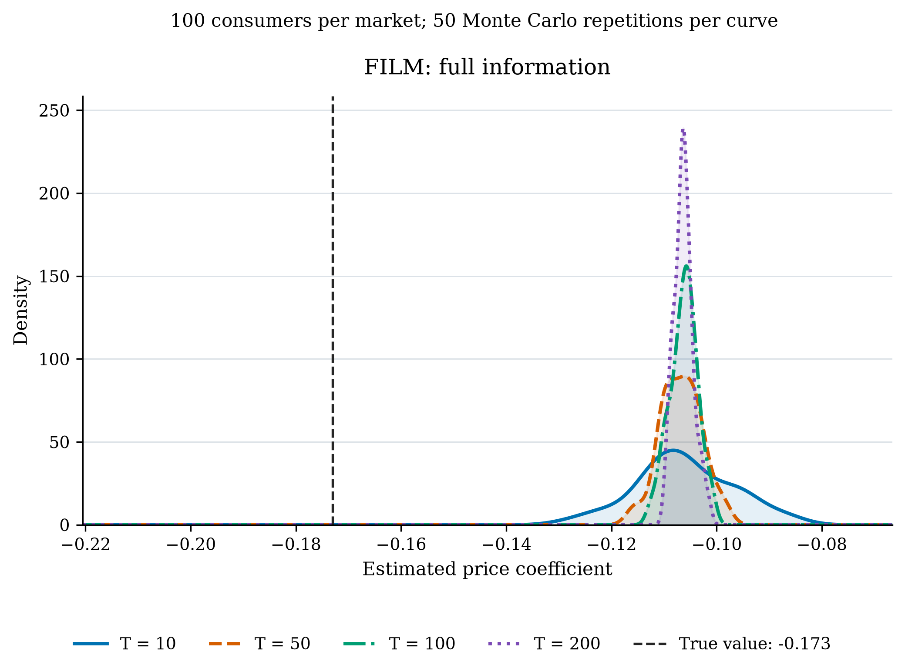

# Logit Models under Limited Consideration

**Statistical Modelling · Structural Estimation · Monte Carlo Simulation · Model Misspecification**


## Overview

Can a choice model recover preferences when it does not know which alternatives consumers actually considered?

This project develops a Python framework to investigate how unobserved consideration sets affect parameter estimation in multinomial logit models. It combines stochastic choice simulation, maximum likelihood estimation and controlled Monte Carlo experiments to compare three approaches: using all available products, using randomly sampled alternatives, and using consumers' true consideration sets.

**Key finding:** In the baseline simulation, both treating all products as considered and randomly sampling alternatives underestimate the magnitude of the price coefficient by approximately **39%**. Using the true consideration sets substantially improves parameter recovery.

This repository is a Python implementation of my 2024 project paper, *Konsistente Schätzungen von Logit-Modellen mit Limited Consideration – Eine Simulationsstudie*, conducted at the Düsseldorf Institute for Competition Economics (DICE), Heinrich Heine University Düsseldorf.

[Model and experimental design](#model-and-experimental-design) · [Simulation outputs](results/) · [Figures](figures/) · [Statistical tables](tables/)

<br>

## Project Highlights

| Experimental scale | Value |
| :--- | ---: |
| Simulated choice observations across the full experiments | **2,300,000** |
| Model estimations across the full experiments | **900** |
| Products per choice occasion | 10 |
| Estimation approaches compared | 3 |
| Table 1: consumers × markets per repetition | 50 × 100 |
| Table 1: Monte Carlo repetitions | 100 |
| Density experiments: consumers per repetition | 100 |
| Density experiments: market counts | 10, 50, 100, 200 |
| Density experiments: repetitions per market count | 50 |

The Table 1 experiment generates 500,000 choices; the four density experiments generate another 1,800,000. Each simulated dataset is used by all three estimators. Observation counts refer to simulated choices before fitting the three models.

**Computational methods:** random consideration-set generation, conditional logit likelihoods, analytic gradients and Hessians, numerical maximum likelihood estimation, Gaussian kernel density estimation and Monte Carlo error quantification.

<br>

## The Decision Problem

A consumer chooses one of ten products on each market occasion. Products differ in price and in product-specific utility effects. The consumer considers only a subset of the products, so an unconsidered product cannot be chosen on that occasion.

Price enters the decision through two channels:

- **Preferences:** A higher price reduces utility, holding the other utility components fixed. The true price coefficient is −0.173.
- **Consideration:** A higher price increases the probability that a product enters the consumer's consideration set in this calibration. Consideration probabilities also differ across products.

The researcher observes choices, prices and product identities. The central challenge is to distinguish preferences from the process determining which alternatives are considered. A product may be unchosen because the consumer dislikes it, or because it never entered the consideration set.

The project compares three estimators using the same simulated choices:

| Model | Alternatives used for estimation |
| :--- | :--- |
| **FILM — Full-Information Logit Model** | All ten products for every choice occasion |
| **MLM — McFadden Logit Model** | The chosen product plus four products sampled uniformly without replacement from the other nine |
| **WLM — True-Choice-Set Logit Model** | The consumer's actual consideration set, observed by construction in the simulation |

The abbreviations follow the original paper. WLM serves as a benchmark with access to information that is generally unavailable to the researcher in applications.

<br>

## Selected Results

The baseline comparison uses 100 Monte Carlo repetitions, each containing 50 consumers making choices across 100 markets. All three estimators are fitted to the same 5,000 decisions in each repetition.

| Model | True price coefficient | Mean estimated coefficient | Underestimation of coefficient magnitude |
| :--- | ---: | ---: | ---: |
| FILM | −0.173000 | −0.106218 | **38.60%** |
| MLM | −0.173000 | −0.105787 | **38.85%** |
| WLM | −0.173000 | −0.171502 | **0.87%** |

Underestimation is calculated by comparing the magnitude of the mean estimated coefficient with the true magnitude of 0.173. These are results from the Python implementation.

[Complete parameter estimates](results/table_1/summary_R100.csv) · [Formatted Table 1](tables/R100/table_1.md)

The density figures below come from a separate set of experiments with 100 consumers and 10, 50, 100 or 200 markets, using 50 repetitions at each market count. Each curve shows the distribution of the estimated price coefficient across repetitions. All figures use the same axes, and the dashed vertical line marks the true coefficient.

### 1. Treating All Products as Considered

**Researcher's assumption:** Every consumer considers all ten products on every choice occasion.

**Consumer's actual behaviour:** Choices are restricted to individual consideration sets generated by a price-dependent and product-dependent attention process.



**Intuition:** The estimator treats an unchosen product as an available alternative that lost to the chosen product. Under limited consideration, some of these products never entered the decision at all. Since consideration probabilities depend on price and product identity, the resulting choice frequencies reflect both preferences and awareness.

In this calibration, higher prices reduce utility but increase consideration probabilities. A model that ignores the second channel attributes the observed choices to preferences alone and estimates a much weaker negative price effect.

**Key result:** The mean price coefficient is **−0.106218**, compared with the true value of **−0.173**. Distortions also affect product coefficients: the mean estimate for product 7 is **+0.4191**, even though its true coefficient relative to product 1 is **−0.5810**. Differences in consideration can therefore be mistaken for differences in underlying product preferences.

<br>

### 2. Sampling Alternatives

**Researcher's approach:** Include the chosen product and four alternatives drawn uniformly from the remaining nine products.

**Consumer's actual behaviour:** The consumer chooses from a separately generated consideration set. The sampled estimation set can include products that the consumer did not consider and omit products that were considered.


**Intuition:** Reducing the number of alternatives in the likelihood does not reveal the consumer's consideration set. The chosen product is always included, but the other four products are sampled from the full product universe without information about the consumer's awareness.

Consequently, this sampling procedure preserves the central information problem. It can still assign positive choice probabilities to products that were not considered on a particular occasion.

**Key result:** The mean price coefficient is **−0.105787**, implying a **38.85%** understatement of its magnitude. This is close to the full-information estimate. Randomly sampling a smaller estimation set does not materially improve price-parameter recovery in this design.

The result concerns this use of sampled alternatives when the underlying consideration sets are unknown; it does not establish that sampling alternatives is generally invalid.

<br>

### 3. Using the True Consideration Sets

**Researcher's information:** The actual consideration set is supplied for every choice occasion.

**Consumer's actual behaviour:** The consumer chooses from exactly that set, with preferences and simulated utility shocks determining the conditional choice probabilities.


**Intuition:** The likelihood now compares the chosen product only with alternatives that genuinely entered the consumer's decision. It no longer needs to explain why the consumer rejected products that were never considered.

**Key result:** The mean price coefficient is **−0.171502**, much closer to the true value of **−0.173**. Product effects also improve: the mean estimate for product 7 is **−0.5785**, compared with the true value of **−0.5810**.

This is a benchmark for the value of knowing the true sets. It does not provide a method for recovering those sets from observed choices. The fitted logit also omits the additional Gaussian utility heterogeneity used in simulation, so access to the true sets does not establish exact unbiasedness or consistency for every parameter.

<br>

### 4. Increasing the Sample Size

**Experimental change:** Hold the number of consumers at 100 and increase the number of markets from 10 to 200. This increases the number of observed choices per repetition from 1,000 to 20,000.

| Markets | Choices per repetition | FILM mean price coefficient | MLM mean price coefficient | WLM mean price coefficient |
| ---: | ---: | ---: | ---: | ---: |
| 10 | 1,000 | −0.106070 | −0.105954 | −0.171382 |
| 50 | 5,000 | −0.106768 | −0.106323 | −0.172160 |
| 100 | 10,000 | −0.106275 | −0.105909 | −0.171541 |
| 200 | 20,000 | −0.106292 | −0.105842 | −0.171445 |

**Intuition:** Larger samples reduce variation across repetitions. They do not supply the missing information about which alternatives consumers considered. A misspecified estimator can therefore become more concentrated around a value far from the true parameter.

For FILM, the standard deviation of the estimated price coefficient falls from approximately **0.00919** at 10 markets to **0.00179** at 200 markets, while its mean remains close to −0.106.

**Key result:** FILM and MLM become more precise as the sample grows, but the substantial price-coefficient bias persists across the sample sizes studied. WLM remains much closer to the true coefficient, without a monotonic disappearance of its smaller residual bias.

[Combined density figure](figures/R50/price_coefficient_distributions.png) · [10-market results](results/density_T10/summary_R50.csv) · [200-market results](results/density_T200/summary_R50.csv)

**Central takeaway:** Accurate preference estimation depends on modelling the alternatives that actually enter the decision. More observations and smaller randomly sampled estimation sets do not, by themselves, resolve missing information about consideration.

<br>

## Model and Experimental Design

The experiments hold the data-generating process fixed and change the alternatives supplied to the likelihood. Within each repetition, all three models use identical observed choices and prices.

1. Generate prices separately for each consumer, market and product, using one third of the product's list price plus a uniform draw between 0 and 16.
2. Draw consideration indicators independently conditional on prices. Inclusion probabilities follow a logistic function with price coefficient 0.15 and product-specific intercepts of −2.5 for products 1–5 and 0 for products 6–10.
3. Generate utilities from the price coefficient, product effects and an additional Gaussian shock with standard deviation 0.25. Draw a choice from logit probabilities restricted to the nonempty true consideration set.
4. Construct the full, sampled and true estimation sets for the same choices.
5. Estimate the price coefficient and nine product coefficients by maximum likelihood, normalising the effect of product 1 to zero.
6. Repeat the experiment and summarise mean estimates, bias, root mean squared error, sampling variability and Monte Carlo standard errors.

There is no outside option. With the default simulation policy, empty consideration sets trigger a redraw of the consideration indicators at the same prices until the set is nonempty. The number of redraws is recorded. Nonempty sets can contain between one and ten products; their size is not restricted to a fixed range within those bounds.

For sampled estimation sets, uniform sampling without replacement gives the same sampling correction for every candidate chosen product within the sampled set under the full-choice-set sampling design. That common term cancels from the conditional logit probabilities. This computational property does not make the sampled set equal to the consumer's true consideration set.

All model parameters, experiment sizes and seed settings are defined in [config.py](config.py).

<br>

## Python Implementation

The code separates configuration, data generation, estimation, Monte Carlo experiments and presentation of results.

| Component | Implementation |
| :--- | :--- |
| Model parameters and experiment settings | [config.py](config.py) |
| Prices, consideration sets and simulated choices | [simulation.py](simulation.py) |
| Conditional logit estimation and standard errors | [estimation.py](estimation.py) |
| Table 1 Monte Carlo experiment | [monte_carlo.py](monte_carlo.py) |
| Sample-size experiments | [monte_carlo_density.py](monte_carlo_density.py) |
| Density figures and formatted tables | [plot_results.py](plot_results.py) |

### Numerical considerations

- Represent choice sets using Boolean availability masks and evaluate probabilities with a numerically stable log-sum-exp calculation.
- Use analytic likelihood gradients and Hessians for estimation, with trust-exact optimisation and a BFGS fallback.
- Calculate conventional model-based standard errors from the inverse observed information matrix, checking that it is suitable for inversion.
- Use deterministic repetition seeds and fit all three models to the same dataset within each repetition.
- Retain repetition-level estimates, standard errors, likelihood values, optimiser diagnostics, experiment settings and software versions.
- Calculate Monte Carlo standard errors from variation across repetition-level estimates, separately from the average model-based standard errors.
- Generate Gaussian density curves using the original R plotting code's bandwidth rule, and export figures in PNG and PDF format.

The workflow connects statistical modelling with practical quantitative research tasks: parameter recovery, numerical optimisation, model-risk analysis and reproducible computational experiments.

<br>

## Quick Start

Open a terminal in the repository folder and install the numerical dependencies in a Python 3 environment:

```bash
python3 -m pip install numpy scipy matplotlib
```

**Run a small estimation demonstration:**

```bash
python3 estimation.py
```

This simulates a small dataset, estimates all three models and prints estimation results and diagnostics.

**Regenerate the figures and Table 1 from saved simulation outputs:**

```bash
python3 plot_results.py
```

This requires the completed Table 1 run and all four density runs. It writes individual and combined density figures to `figures/R50/`, and formatted Table 1 outputs to `tables/R100/`.

**Reproduce the full Monte Carlo experiments:**

```bash
python3 monte_carlo.py --experiment table
python3 monte_carlo_density.py
python3 plot_results.py
```

The default configuration uses 100 repetitions for Table 1 and 50 repetitions at each of the four density sample sizes, giving 900 model estimations in total. Full experiments are more computationally demanding than the small demonstration and overwrite the corresponding output files. Settings are defined in [config.py](config.py).

For a small Monte Carlo run that saves CSV outputs, use `python3 monte_carlo.py --experiment demo`. To run a single density specification, use, for example, `python3 monte_carlo_density.py --markets 50`.

<br>

## Repository Structure

| Path | Contents |
| :--- | :--- |
| `README.md` | Project overview, selected results and instructions |
| `config.py` | Model calibration, experiment profiles and seeds |
| `simulation.py` | Data generation and consideration-set construction |
| `estimation.py` | Likelihood, optimisation and model-based standard errors |
| `monte_carlo.py` | Table 1 and demonstration experiments |
| `monte_carlo_density.py` | Experiments across the four market counts |
| `plot_results.py` | Density plots and formatted tables |
| `results/table_1/` | Raw estimates, summaries, comparison table and settings for Table 1 |
| `results/density_T10/` to `results/density_T200/` | Corresponding outputs for the four density experiments |
| `figures/R50/` | Individual and combined density plots in PNG and PDF format |
| `tables/R100/` | Table 1 in Markdown, PNG and PDF format |

**Technology stack:** Python · NumPy · SciPy · Matplotlib · Git

<br>

## Research Provenance and Limitations

The original project paper was completed in 2024 using MATLAB for data generation and R's `mlogit` package for estimation. This repository implements the simulation, estimation and visualisation workflow in Python. The numerical results reported above come from the Python implementation; exact numerical equality with the original MATLAB/R experiments is not claimed. Reusing seed numbers does not establish identical random draws across languages.

The implementation follows the supplied original code where it differs from the paper's prose. In particular, the MATLAB code uses Gaussian utility shocks with standard deviation **0.25**, while Section 3.1 of the paper specifies a standard normal distribution. The Python implementation also adds explicit handling of empty consideration sets, which the original MATLAB code does not provide.

The fitted models omit the additional Gaussian utility heterogeneity present in the simulation. Consequently, the WLM results demonstrate substantially better recovery in this calibration, rather than a general guarantee of unbiasedness or consistency. The experiments use simulated data and do not identify consumers' unknown consideration sets in an empirical application.

In the formatted Table 1, parentheses contain the **average model-based standard error across repetitions**. These are distinct from Monte Carlo standard errors of the estimated means. Stars preserve the original R presentation rule based on the mean estimate divided by the mean model standard error; they are not formal tests of the Monte Carlo mean. Monte Carlo variability, bias and RMSE are reported separately in the summary CSV files.

<br>

## References

McFadden, D. (1978). Modelling the choice of residential location. In *Spatial Interaction Theory and Planning Models*, pp. 75–96. North-Holland.

Abaluck, J., & Adams-Prassl, A. (2021). What do consumers consider before they choose? Identification from asymmetric demand responses. *The Quarterly Journal of Economics*, 136(3), 1611–1663.

---

**Elias Roth**  
MPhil Economics | University of Oxford  
[GitHub Profile](https://github.com/EliasBernhardRoth)
